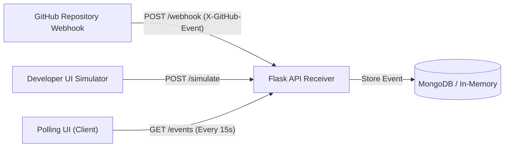

# GitHub Webhook Stream & Activity Monitor 🐙⚡

> Real-time GitHub Webhook event ingestion microservice and live polling feed dashboard built with Flask, MongoDB, and modern vanilla JavaScript.

[](LICENSE)
[](https://flask.palletsprojects.com/)
[](https://www.mongodb.com/)
[](https://developer.mozilla.org/)

---

## 🌟 Overview

This project implements a full lifecycle GitHub Webhook receiver and subscriber system:
1. **Webhook Ingestion:** Receives raw JSON payloads from GitHub webhooks on `/webhook`.
2. **Payload Normalization:** Extracts author handles, commit SHAs, source/target branches, pull request status, and UTC timestamps.
3. **Dual Storage Architecture:** Persists structured records in MongoDB with automatic in-memory queue fallback for rapid local prototyping without external infrastructure dependencies.
4. **Polling Dashboard:** A responsive, GitHub-styled activity stream UI that periodically polls `/events` and provides immediate one-click simulation buttons.

---

## 🏗️ Architecture



---

## 🚀 Quickstart

### 1. Start Webhook API Backend

```bash
cd webhook-repo
python -m venv venv
source venv/bin/activate  # On Windows: venv\Scripts\activate
pip install -r requirements.txt

# (Optional) Customize MongoDB URI via .env or environment variable
# export MONGO_URI="mongodb://localhost:27017/github_events"

python app.py
```
Backend will start on `http://localhost:5000`.

### 2. Launch Polling Dashboard

```bash
cd ../polling-ui
# Open directly in your browser:
start index.html
# Or serve with Python:
python -m http.server 3000
```
Open `http://localhost:3000` to view the live event stream. Click **+ Push Event**, **+ Pull Request**, or **+ Merge Event** to simulate live activity!

---

## 🔌 Webhook Endpoints

| Method | Endpoint | Description |
| :--- | :--- | :--- |
| `GET` | `/` | Service health status and storage mode. |
| `POST` | `/webhook` | Ingests GitHub webhook deliveries (`push`, `pull_request`). |
| `GET` | `/events` | Returns recent 20 events ordered by latest timestamp. |
| `POST` | `/simulate` | Development helper to inject mock GitHub events without ngrok. |

---

## 📄 License

This project is licensed under the [MIT License](LICENSE).
